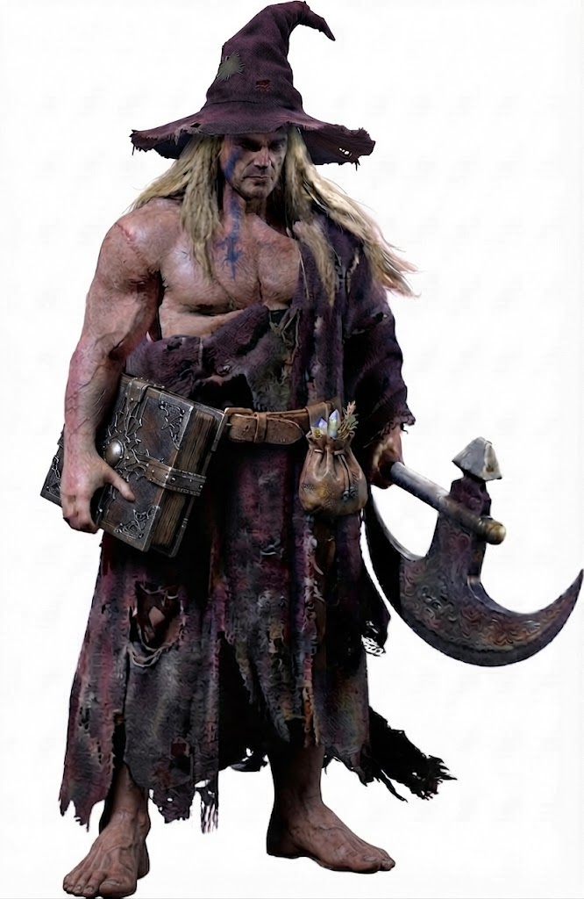

# Brigby's Character Sheet
**Dungeons & Dragons 3.5 Edition • Barbarian (1) / Sorcerer (1)**

## Core Identity
* **Character Name:** Brigby
* **Race:** Human
* **Class:** Barbarian 1 / Sorcerer 1
* **Alignment:** Chaotic Neutral
* **Deity:** Deneir

## Ability Scores
* **STR:** 15 (+2)
* **DEX:** 12 (+1)
* **CON:** 15 (+2)
* **INT:** 10 (+0)
* **WIS:** 10 (+0)
* **CHA:** 12 (+1)

## Combat Statistics (Normal)
* **Hit Points:** 19 (12 Max d12 + 3 d4 roll + 4 CON)
* **Armor Class:** 11 (+1 DEX) / 15 with *Mage Armor* active
* **Initiative:** +1
* **Base Attack Bonus:** +1 (+1 Barbarian / +0 Sorcerer)
* **Saving Throws:** Fort +4, Ref +1, Will +2 (+2 Fort / +0 Ref / +0 Will from Barbarian; +0 Fort / +0 Ref / +2 Will from Sorcerer)
* **Trident (One-Handed):** Attack +3, Damage 1d6-2, Crit x2

## Raging Combat Statistics (1/day, Duration: 7 rounds)
* **Temporary Ability Scores:** STR 19 (+4), CON 19 (+4)
* **Temporary Hit Points:** 23 (+4 current and max HP while raging)
* **Armor Class:** 9 (+1 DEX, -2 Rage penalty) / 13 with *Mage Armor* active
* **Saving Throws:** Fort +6 (+2 CON), Ref +1, Will +4 (+2 Morale bonus)
* **Trident (One-Handed):** Attack +5 (+2 STR), Damage 1d6 (1d6-2 base + 2 STR), Crit x2
* **Trident (Two-Handed):** Attack +5 (+2 STR), Damage 1d6+3 (1d6-2 base + 5 STR [1.5x]), Crit x2
* **Climb Check:** +8 (+4 STR)
* **Rage Restrictions:** Cannot cast spells, concentrate, or use DEX-, INT-, or CHA-based skills.

## Feats & Class Features
* **Power Attack (Feat):** On your action, before making attack rolls for a round, you can choose to subtract a number from all melee attack rolls and add the same number to all melee damage rolls. This number cannot exceed your base attack bonus. If you attack with a two-handed weapon, you instead add twice the number subtracted to your damage rolls.
* **Cleave (Feat):** If you deal a creature enough damage to make it drop (typically by reducing its hit points to 0 or lower, killing it, etc.), you get an immediate extra melee attack against another creature within reach. You cannot take a 5-step move during this extra attack, but the extra attack is with the same weapon and at the same bonus as the attack that dropped the previous creature. You can use this ability once per round.
* **Fast Movement (Ex):** Your land speed is faster than the norm for your race by +10 feet. This benefit applies only when you are unarmored or wearing light or medium armor and not carrying a heavy load.
* **Rage (Ex, 1/day):** You can fly into a fit of fierce rage. While raging, you temporarily gain +4 to Strength, +4 to Constitution, and a +2 morale bonus on Will saves, but you take a -2 penalty to Armor Class. The increase to Constitution grants you +2 hit points per Hit Die (4 HP total), which disappear when the rage ends. While raging, you cannot use any Charisma-, Dexterity-, or Intelligence-based skills, concentration, or any abilities that require patience or concentration (including spellcasting). A rage lasts for a number of rounds equal to 3 + your newly modified Constitution modifier (7 rounds total). At the end of the rage, you are fatigued (-2 Strength, -2 Dexterity, can't charge or run) for the duration of the encounter.
* **Summon Familiar:** Can obtain a familiar.
* **Arcane Spell Failure:** Casting spells with somatic components while wearing armor incurs a chance of spell failure (if wearing light armor/holding a shield).

## Spells & Arcana
* **Caster Level:** 1st
* **Spell DC:** 11 + Spell Level (11 for Cantrips, 12 for 1st-Level)
* **Spell Slots (per day):** 0-level: 5/day | 1st-level: 4/day (3 base + 1 bonus for 12 CHA)

### Spells Known & Descriptions

#### 0-Level Cantrips (DC 11)
* ***Resistance*** *(Abjuration)*
  * **Casting Time:** 1 standard action | **Range:** Touch | **Target:** Creature touched | **Duration:** 1 minute | **Saving Throw:** Will negates (harmless) | **Spell Resistance:** Yes (harmless)
  * **Effect:** You touch a creature and grant it a +1 resistance bonus on all saving throws.
* ***Light*** *(Evocation [Light])*
  * **Casting Time:** 1 standard action | **Range:** Touch | **Target:** Object touched | **Duration:** 10 minutes/level (10 min) (D) | **Saving Throw:** None | **Spell Resistance:** No
  * **Effect:** Causes an object to glow like a torch, shedding bright light in a 20-foot radius (and dim light for an additional 20 feet) from the point you touch.
* ***Mage Hand*** *(Transmutation)*
  * **Casting Time:** 1 standard action | **Range:** Close (25 ft. + 5 ft./2 levels) (25 ft.) | **Target:** One unattended object weighing up to 5 lbs. | **Duration:** Concentration | **Saving Throw:** None | **Spell Resistance:** No
  * **Effect:** You point your finger at an object and lift it and move it at a distance. As a move action, you can propel the object up to 15 feet in any direction.
* ***Message*** *(Transmutation [Language-Dependent])*
  * **Casting Time:** 1 standard action | **Range:** Medium (100 ft. + 10 ft./level) (110 ft.) | **Targets:** One creature/level (1 creature) | **Duration:** 10 minutes/level (10 min) | **Saving Throw:** None | **Spell Resistance:** No
  * **Effect:** You point your finger at each creature you want to target and whisper your message. The targets (and only the targets) hear the whisper and can whisper a reply back that only you hear.

#### 1st-Level Spells (DC 12)
* ***Mage Armor*** *(Conjuration [Creation])*
  * **Casting Time:** 1 standard action | **Range:** Touch | **Target:** Creature touched | **Duration:** 1 hour/level (1 hour) (D) | **Saving Throw:** Will negates (harmless) | **Spell Resistance:** No
  * **Effect:** An invisible but tangible field of force surrounds the subject, providing a +4 armor bonus to AC. Unlike ordinary armor, *Mage Armor* entails no armor check penalty, arcane spell failure chance, or speed reduction. Because it is made of force, incorporeal creatures cannot bypass it.
* ***True Strike*** *(Divination)*
  * **Casting Time:** 1 standard action | **Range:** Personal | **Target:** You | **Duration:** See text
  * **Effect:** You gain temporary, intuitive insight into the immediate future. Your next single attack roll (if made before the end of the next round) gains a +20 insight bonus. Additionally, you are not affected by the miss chance that applies to attackers targeting a concealed target.

## Skills
* **Climb:** +6 (+8 while Raging)
* **Concentration:** +4
* **Intimidate:** +5
* **Handle Animal:** +5
* **Listen:** +4
* **Spellcraft:** +1
* **Survival:** +4

## Equipment & Wealth
* **Weapons & Armor:** Trident (1d6-2 damage standard, 1d6 raging 1-hand, 1d6+3 raging 2-hand), Tattered Wizard's Robe, Tattered Pointy Wizard's Hat (Non-magical), Plague Mask
* **Gear:** Backpack, Waterskin, Rations (4 days), Bedroll, Flint & Steel, Spell Component Pouch, Antidote Potions (3)
* **Wealth:** 10 sp

## Character Description & Backstory
"Brigby stands tall and imposing, his bulging muscles straining against the shreds of a tattered, threadbare wizard's robe. Looking thoroughly worse for wear, he wears a battered, crooked wizard's hat with solemn pride. Having finally unlocked true arcane powers through sheer force of personality, he believes his martial ferocity and burgeoning spellcraft are simply two sides of the same glorious arcane coin. He clutches a heavy, metal-bound tome under one arm with absolute reverence, and bears a large tattoo of Deneir's insignia across his back."