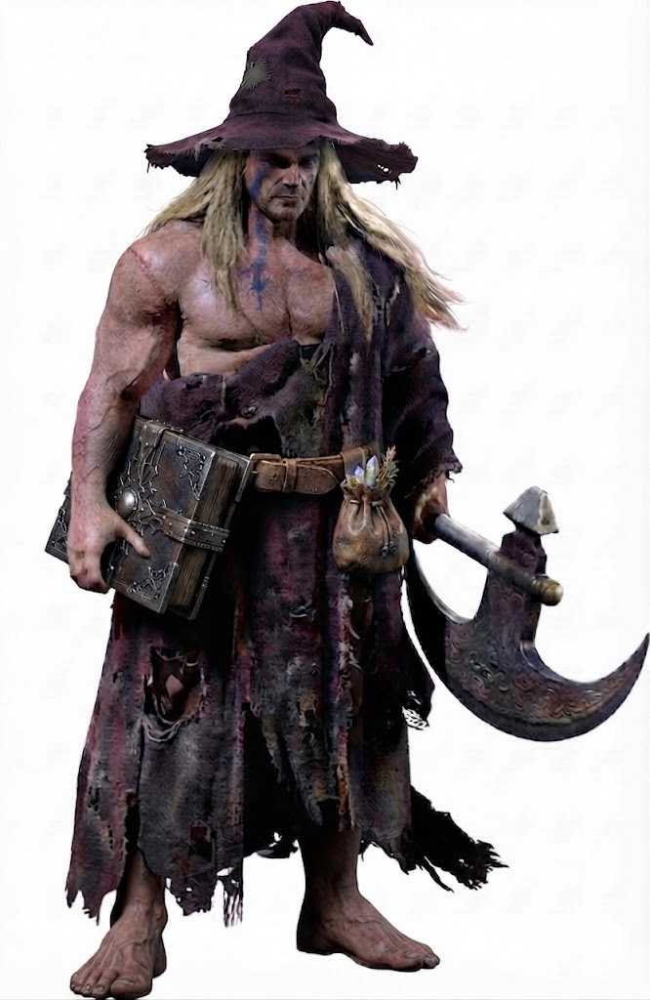

# Brigby's Character Sheet
**Dungeons & Dragons 3.5 Edition • Barbarian (Level 1)**

## Core Identity
* **Character Name:** Brigby
* **Race:** Human
* **Class:** Barbarian (1)
* **Alignment:** Chaotic Neutral
* **Deity:** Deneir

## Ability Scores
* **STR:** 15 (+2)
* **DEX:** 12 (+1)
* **CON:** 15 (+2)
* **INT:** 10 (+0)
* **WIS:** 10 (+0)
* **CHA:** 12 (+1)

## Combat Statistics
* **Hit Points:** 14 (12 Max d12 + 2 CON)
* **Armor Class:** 11 (+1 DEX)
* **Initiative:** +1
* **Base Attack Bonus:** +1
* **Saving Throws:** Fort +4, Ref +1, Will +0
* **Greataxe (Two-Handed):** Attack +3, Damage 1d12+3, Crit x3

## Feats & Class Features
* **Power Attack (Feat):** On your action, before making attack rolls for a round, you can choose to subtract a number from all melee attack rolls and add the same number to all melee damage rolls. This number cannot exceed your base attack bonus. If you attack with a two-handed weapon, you instead add twice the number subtracted to your damage rolls. (Currently: up to -1 attack for +2 damage).
* **Cleave (Feat):** If you deal a creature enough damage to make it drop (typically by reducing its hit points to 0 or lower, killing it, etc.), you get an immediate extra melee attack against another creature within reach. You cannot take a 5-step move during this extra attack, but the extra attack is with the same weapon and at the same bonus as the attack that dropped the previous creature. You can use this ability once per round.
* **Fast Movement (Ex):** Your land speed is faster than the norm for your race by +10 feet. This benefit applies only when you are unarmored or wearing light or medium armor and not carrying a heavy load.
* **Rage (Ex, 1/day):** You can fly into a fit of fierce rage. While raging, you temporarily gain +4 to Strength, +4 to Constitution, and a +2 morale bonus on Will saves, but you take a -2 penalty to Armor Class. The increase to Constitution grants you +2 hit points per Hit Die, which disappear when the rage ends. While raging, you cannot use any Charisma-, Dexterity-, or Intelligence-based skills, concentration, or any abilities that require patience or concentration. A rage lasts for a number of rounds equal to 3 + your newly modified Constitution modifier (5 rounds total). At the end of the rage, you are fatigued (-2 Strength, -2 Dexterity, can't charge or run) for the duration of the encounter.

## Skills
* **Climb:** +6
* **Intimidate:** +5
* **Handle Animal:** +5
* **Listen:** +4
* **Survival:** +4

## Equipment & Wealth
* **Weapons & Armor:** Greataxe, Tattered Wizard's Robe, Tattered Pointy Wizard's Hat (Non-magical)
* **Gear:** Backpack, Waterskin, Rations (4 days), Bedroll, Flint & Steel, Reagent Pouch
* **Wealth:** 89 pp

## Character Description & Backstory
"Brigby stands tall and imposing, his bulging muscles straining against the shreds of a tattered, threadbare wizard's robe. Looking thoroughly worse for wear, he wears a battered, crooked wizard's hat with solemn pride, firmly convinced that his towering physique and ferocious rage are simply the manifestations of a rare, high-level martial arcana. He clutches a heavy, metal-bound tome under one arm with absolute reverence, and bears a large tattoo of Deneir's insignia across his back."
